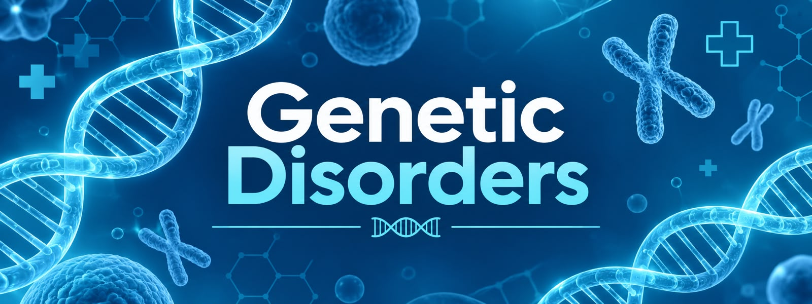

<div align="center">

# 🧬 Genetic Disorders - ML

**Clasificación de trastornos genéticos con Machine Learning**

<a href="https://youtu.be/TU_VIDEO"></a>
<a href="https://colab.research.google.com/github/TU_USUARIO/genetic-disorders-ml/blob/main/MAIN_Genetic_Disorders_ML.ipynb"></a>
<a href="https://LINK_A_TU_DATASET"></a>

</div>

---

<div align="center">
    
</div>

---

## 👥 Integrantes

| Nombre | Código | Correo |
|--------|--------|--------|
| Sara Gamboa Morales | 2251886 | sara2251886@correo.uis.edu.co |
| Andrés Gonzalez Suarez | 2252108 | andres2252108@correo.uis.edu.co |
| Santiago Muñoz Mantilla | 2251514 | santiago2251514@correo.uis.edu.co |

**Curso:** Aprendizaje de Máquina · **Universidad:** UIS · **Semestre:** 2026-2

---

## 📌 Descripción

Proyecto que busca predecir la categoría de trastorno genético de un paciente a partir de variables clínicas y de herencia. Incluye inspección y limpieza de datos, análisis exploratorio (EDA), preprocesamiento y comparación de varios modelos de clasificación.

## 🎯 Objetivos

**Objetivo general**
- Desarrollar un modelo de Machine Learning capaz de clasificar trastornos genéticos a partir de datos de pacientes.

**Objetivos específicos**
- Realizar el análisis exploratorio y la limpieza del conjunto de datos.
- Preprocesar las variables (imputación de nulos y codificación de categóricas).
- Comparar modelos: Gaussian Naive Bayes, Árbol de Decisión, Random Forest y SVM.
- Manejar el desbalance de clases y evaluar el modelo final con métricas adecuadas.

## 🗂️ Base de datos

- **Archivo:** `train_genetic_disorders.csv`
- **Variable objetivo:** `Genetic Disorder`, con 3 categorías:
  - Mitochondrial genetic inheritance disorders
  - Single-gene inheritance diseases
  - Multifactorial genetic inheritance disorders
- **Fuente:** [enlace al dataset](https://LINK_A_TU_DATASET)

> El dataset no se incluye en el repositorio. Descárgalo y ajusta la ruta en la primera celda del notebook.

## 🔬 Metodología

1. **Inspección:** tamaño del dataset, distribución de la variable objetivo y valores nulos.
2. **Limpieza:** eliminación de registros sin objetivo y de columnas no clínicas.
3. **EDA:** gráficos de distribución y relaciones entre variables.
4. **Preprocesamiento:** mediana y moda para nulos, *one-hot encoding*.
5. **Modelado:** prueba binaria con cuatro modelos y luego modelo final multiclase.
6. **Evaluación:** partición 70/15/15 (entrenamiento, validación, prueba), reporte de clasificación y matriz de confusión.

## 📊 Resultados

| Modelo | Accuracy | Recall | F1 |
|--------|----------|--------|----|
| Random Forest | - | - | - |

<!-- Pega aquí la matriz de confusión:  -->

## 🛠️ Tecnologías


## 📁 Estructura del repositorio

```
genetic-disorders-ml/
├── assets/
│   └── banner.png
├── MAIN_Genetic_Disorders_ML.ipynb
├── requirements.txt
└── README.md
```

## ▶️ Cómo ejecutarlo

1. Abre el notebook con el botón **Código** de arriba (Google Colab).
2. Sube el dataset a tu Google Drive.
3. Cambia la variable `ruta` de la primera celda por la ubicación de tu archivo.
4. Ejecuta las celdas en orden.

---

<div align="center">
  Hecho con 💙 para el curso de Aprendizaje de Máquina · UIS
</div>
